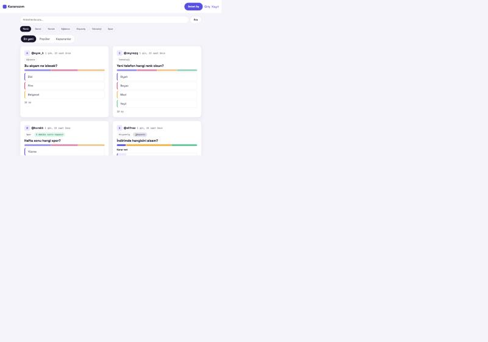

# Kararsızım

Kararsız kaldığın konularda başkalarına danışabildiğin, basit bir anket uygulaması.
*"Bugün sinemaya mı gitsem, restorana mı?"* gibi sorular için hızlıca anket aç; misafir ya da üye olarak oy ver, sonucu gör.

**🔗 Canlı demo:** **https://kararsizim-pink.vercel.app**



## Ne yapabilirsin?

- **Üye olmadan** anketleri görüntüle ve oy ver (çerez tabanlı misafir oyu, hesap gerekmez)
- Üye olup **kendi anketini aç** — 2 ile 5 arasında seçenek, isteğe bağlı kategori ve bitiş süresi
- Oy verdikten sonra (ya da anket sahibiysen her zaman) sonuçları **yüzde + oy sayısı + renkli çubuk** olarak gör
- Ana sayfada **"En yeni" / "Popüler" / "Kapananlar"** sekmeleri, kategori filtresi ve arama
- Kendi açtığın anketi istediğin zaman **silebilirsin**
- Tamamen **Türkçe arayüz**, mobil öncelikli tasarım

## Kullanılan teknolojiler

| Katman | Seçim |
|---|---|
| Backend | Django 5.2 (sunucu taraflı render, ekstra bir frontend framework yok) |
| Veritabanı | [Supabase](https://supabase.com) (yalnızca PostgreSQL olarak), yerelde SQLite |
| Frontend | Saf HTML + CSS + JavaScript (`templates/`, `static/`) |
| Yayın | [Vercel](https://vercel.com) |

Bilinçli olarak sade tutuldu: React/Vue, Tailwind, DRF, Celery, Redis, Docker gibi araçlar **kullanılmıyor**.

## Yerelde çalıştırma

```bash
python3 -m venv .venv
source .venv/bin/activate
pip install -r requirements.txt
cp .env.example .env
python manage.py migrate
python manage.py runserver
```

`DATABASE_URL` tanımlı değilse proje otomatik olarak SQLite'a düşer, yani yukarıdaki adımlar dışında ekstra bir veritabanı kurulumu gerekmez.

Testleri çalıştırmak için:

```bash
python manage.py test
```

---

Projenin tüm ürün kuralları, veri modeli, tasarım rehberi ve geliştirme fazları için [CLAUDE.md](CLAUDE.md) dosyasına bakabilirsin.
